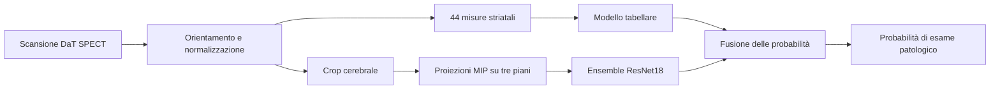

# Classificazione di scansioni DaT SPECT per il Parkinson

[English](README.md) · Italiano

Ho sviluppato questa pipeline per la [DaT Parkinson's Challenge di DrivenData](https://www.drivendata.org/competitions/311/). Il compito è stimare, a partire da una scansione DaT SPECT, la probabilità che l'esame sia patologico. Il progetto copre preprocessing, estrazione delle feature, addestramento, valutazione e inferenza nella submission.

Il mio obiettivo non era trovare il modello più grande, ma capire **quale informazione mancasse al modello precedente** e verificare ogni modifica su protocolli di acquisizione diversi. Il risultato è una fusione tra misure striatali e un modello che osserva direttamente le immagini.

## Il problema tecnico

Le scansioni provengono da protocolli diversi. Orientamento, risoluzione e scala delle intensità possono cambiare senza che cambi la classe clinica. Una validazione casuale rischia quindi di premiare scorciatoie legate all'acquisizione. Inoltre, le misure riassuntive dello striato sono utili, ma comprimono un volume intero in pochi numeri e possono perdere dettagli spaziali.



## Perché ho fatto queste scelte

**Normalizzazione per singolo esame.** Divido le intensità per un riferimento ricavato dalla stessa scansione. I conteggi grezzi dipendono anche dal centro e dai parametri di acquisizione; un rapporto interno riduce questo effetto. Ogni esame viene elaborato indipendentemente dagli altri, anche in inferenza.

**Crop centrato sul cervello, non sullo striato.** Se centrassi il crop sul segnale striatale, il deterioramento del segnale potrebbe spostare il crop e cancellare proprio un'informazione utile. Il baricentro cerebrale offre un riferimento più stabile. Controllo inoltre l'orientamento antero-posteriore: un asse invertito cambierebbe il significato delle misure caudato/putamen senza produrre un errore di esecuzione.

**Feature interpretabili e immagini insieme.** Le 44 misure di uptake, asimmetria e morfologia forniscono un ramo tabellare veloce e leggibile. Le tre proiezioni di massima intensità (MIP) permettono a ResNet18 di usare dettagli che queste misure non conservano. Ho mantenuto entrambi i rami perché la loro complementarità conta più del punteggio isolato di ciascuno.

**Validazione costruita attorno al cambio di protocollo.** Uso fold raggruppati per impronta di acquisizione, stimo i coefficienti della fusione in modo annidato e controllo il risultato con un test leave-protocol-out. In questo modo valuto la fusione su esami che non hanno contribuito alla scelta dei suoi pesi e verifico quanto regga fuori dai protocolli visti in addestramento.

**Regolarizzazione prima di aggiungere complessità.** Ho confrontato regressione logistica, SVM, alberi e boosting. Una logistica più regolarizzata è meno forte da sola, ma migliora la fusione con le MIP. Ho poi aggiunto descrittori di simmetria voxel per voxel dopo un allineamento rigido: gli stessi descrittori senza allineamento peggioravano il test esterno. Questo confronto mi ha indicato che rendere confrontabili i voxel dei due emisferi era più utile che aggiungere semplicemente altre feature.

**Artefatti verificabili.** Il pacchettatore lega modello, checkpoint, coefficienti di fusione e rapporto di valutazione tramite manifest e controlli di integrità. Mantengo il candidato separato dal modello già validato, così una modifica sperimentale non cambia accidentalmente il percorso di inferenza esistente.

## Risultati

| Configurazione | CV raggruppata con fusione annidata | Leave-protocol-out |
| --- | ---: | ---: |
| Modello tabellare iniziale + MIP | 0,2374 log loss / 0,9657 AUROC | 0,2409 / 0,9647 |
| Logistica regolarizzata + MIP | 0,2339 / 0,9667 | 0,2387 / 0,9648 |
| Ensemble con simmetria registrata + MIP | **0,2323 / 0,9673** | **0,2375 / 0,9652** |

Le stime interne utilizzano 1.362 scansioni etichettate. Il modello iniziale ha ottenuto **0,2675 log loss / 0,9544 AUROC** nell'ultima valutazione pubblica riportata; per il candidato con registrazione non riporto un punteggio pubblico. I miglioramenti interni sono piccoli e non eliminano l'incertezza dovuta ai gruppi di acquisizione. Il [registro delle decisioni](docs/DECISIONS.md) documenta anche gli esperimenti respinti e i limiti osservati; in [`experiments/risultati`](experiments/risultati) sono disponibili i riepiloghi aggregati.

## Struttura e riproduzione

| Percorso | Contenuto |
| --- | --- |
| `src/` | Preprocessing, misure, allineamento, modelli e inferenza condivisa |
| `scripts/` | Ispezione dati, training, valutazione e creazione della submission |
| `submission_src/` | Punto di ingresso per il runtime della competizione |
| `tests/` | Test su volumi sintetici e contratti degli artefatti |
| `docs/DECISIONS.md` | Ipotesi, confronti e decisioni sperimentali |

Per eseguire i test senza dati della competizione servono Python 3.12 e le dipendenze indicate in `requirements.txt`:

```bash
python -m venv .venv
# Attivare .venv secondo la propria shell.
python -m pip install -r requirements.txt pytest
python -m pytest -q
```

I test del ramo immagini vengono saltati se PyTorch non è installato. Cinque test di integrazione del runtime richiedono un `models/models.pkl` allenato localmente.

Con i dati ottenuti secondo le regole della competizione, conservati **fuori dalla repository** in una cartella con `niftis/` e `train_labels.csv`:

```bash
python scripts/00_inspect_data.py --data-dir /percorso/dati
python scripts/01_extract_features.py --data-dir /percorso/dati --out features_v4.csv
python scripts/02_train_cv.py --features features_v4.csv --out-dir models
python scripts/08_extract_crops.py --data-dir /percorso/dati --features features_v4.csv --out crops
```

L'addestramento del ramo immagini parte da `scripts/10_voxel_cnn.py` e richiede PyTorch, torchvision, pesi ImageNet locali e una GPU CUDA. `scripts/37_gold_standard.py` e `scripts/39_registration_symmetry.py` riproducono i confronti a partire dalle predizioni out-of-fold salvate. `scripts/03_pack_submission.py` prepara il pacchetto finale dopo aver verificato gli artefatti necessari.

## Limiti e dati

Questo è un progetto di ricerca e competizione, **non uno strumento diagnostico**. Le metriche di validazione interna non dimostrano prestazioni cliniche né generalizzazione su ospedali esterni alla competizione. Le [regole di DrivenData](https://www.drivendata.org/competitions/311/dat-parkinsons-challenge/rules/) consentono di condividere pubblicamente il codice, ma limitano la diffusione dei dati. Per questo la repository non include scansioni, etichette, pesi allenati o predizioni per singolo esame. Il codice è distribuito con [licenza MIT](LICENSE).
