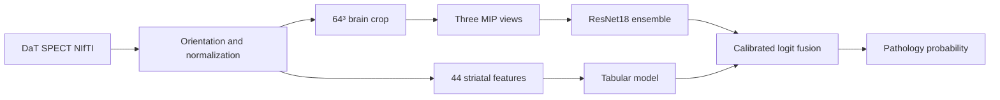

# DaT SPECT Parkinson's classification

An end-to-end machine learning project for the [DrivenData DaT Parkinson's Challenge](https://www.drivendata.org/competitions/311/). It classifies DaT SPECT scans as pathological or non-pathological. The repository contains the training, evaluation, and inference code; competition images, labels, fitted weights, and per-scan predictions are deliberately excluded.

> **Research/competition project only.** The reported scores are competition and internal validation results, not evidence of clinical validity. This code is not a diagnostic device.

## What I built

- A reproducible image pipeline that canonicalizes NIfTI volumes, measures striatal uptake, and generates brain-centered crops.
- A tabular branch using 44 uptake and morphology features, plus a ResNet18 branch trained on three orthogonal maximum-intensity projections.
- Grouped cross-validation, nested fusion fitting, and a leave-protocol-out stress test to check whether gains survive changes in acquisition protocol.
- An experimental extension using rigid alignment and voxel-wise symmetry descriptors. The original model remains separate from the candidate, with packaging checks that tie model, fusion coefficients, and evaluation report to the same branch.
- Synthetic phantom tests and a submission packager with artifact integrity checks.



## Results

| Model | Grouped nested CV log loss / AUROC | Leave-protocol-out log loss / AUROC |
| --- | ---: | ---: |
| Original tabular + MIP | 0.2374 / 0.9657 | 0.2409 / 0.9647 |
| Regularized tabular + MIP | 0.2339 / 0.9667 | 0.2387 / 0.9648 |
| Registered symmetry ensemble + MIP | **0.2323 / 0.9673** | **0.2375 / 0.9652** |

These estimates come from 1,362 labeled training scans. The original model's most recent public challenge score was **0.2675 log loss / 0.9544 AUROC**. The registered candidate has **no public score reported here**; its numbers are internal validation estimates. See [experimental decisions](docs/DECISIONS.md) and the aggregate JSON reports in [`experiments/risultati`](experiments/risultati) for the evaluation details. Small differences should be read with the documented group-level uncertainty in mind.

## Run locally

Python 3.12 and the package versions in `requirements.txt` mirror the competition runtime. PyTorch and torchvision are required for the image branch and should be installed in compatible versions for your platform. A CUDA GPU is required by the image-training script. Access to the challenge data requires accepting the organizer's terms.

```bash
python -m venv .venv
# Activate .venv with your shell's activation command.
python -m pip install -r requirements.txt pytest
python -m pytest -q
```

The tabular and synthetic-scan tests run without challenge data. Image-model tests skip when PyTorch is unavailable; five runtime integration tests skip until a local `models/models.pkl` has been trained.

With authorized challenge data stored **outside this repository** in a directory containing `niftis/` and `train_labels.csv`:

```bash
python scripts/00_inspect_data.py --data-dir /path/to/challenge-data
python scripts/01_extract_features.py --data-dir /path/to/challenge-data --out features_v4.csv
python scripts/02_train_cv.py --features features_v4.csv --out-dir models
python scripts/08_extract_crops.py --data-dir /path/to/challenge-data --features features_v4.csv --out crops
```

The GPU training entry point is `scripts/10_voxel_cnn.py`. It needs locally available ImageNet weights and the generated crops; run `python scripts/10_voxel_cnn.py --help` for configuration. The experiments in `scripts/37_gold_standard.py` and `scripts/39_registration_symmetry.py` consume the saved out-of-fold predictions from that stage. The final package is built by `scripts/03_pack_submission.py` after the appropriate model and evaluation artifacts exist.

## Repository map

| Path | Purpose |
| --- | --- |
| `src/` | Shared preprocessing, features, alignment, model, and inference code |
| `scripts/` | Data inspection, training, evaluation, and packaging entry points |
| `submission_src/` | Competition runtime entry point |
| `tests/` | Synthetic and contract tests |
| `docs/DECISIONS.md` | Experimental decisions, rejected alternatives, and limitations |
| `experiments/risultati/*.json` | Aggregate evaluation summaries only |

The [competition rules](https://www.drivendata.org/competitions/311/dat-parkinsons-challenge/rules/) permit public sharing of participant code but restrict sharing the challenge data. No scans, labels, fitted model weights, or per-scan predictions are included. The code is released under the [MIT License](LICENSE).
