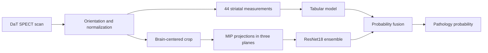

# Parkinson's classification from DaT SPECT scans

English · [Italiano](README.it.md)

I built this pipeline for the [DrivenData DaT Parkinson's Challenge](https://www.drivendata.org/competitions/311/). Given a DaT SPECT scan, it estimates the probability that the scan is pathological. The project covers preprocessing, feature extraction, training, evaluation, and inference in the competition runtime.

My aim was to identify **what information the previous model was missing** and test each change across acquisition protocols. The resulting system combines striatal measurements with a model that sees the images themselves.

## The technical problem

The scans come from different acquisition protocols. Orientation, resolution, and intensity scale can change without a change in the clinical label. A random validation split can reward acquisition-specific shortcuts. At the same time, summary measurements of the striatum are useful but compress an entire volume into a small number of values, losing some spatial detail.



## Why I made these choices

**Normalize each scan independently.** I divide intensities by a reference measured within the same scan. Raw counts reflect the acquisition center and scanner settings as well as the underlying signal; within-scan ratios reduce that dependence. Each scan is also processed independently at inference time.

**Center the crop on the brain.** Centering on the striatal signal could make the crop move as that signal deteriorates, removing information the model needs. The brain centroid provides a more stable reference. I also check the anterior-posterior direction: a reversed axis would change the meaning of caudate and putamen measurements without raising an execution error.

**Combine interpretable features with images.** The 44 uptake, asymmetry, and morphology measurements provide a fast, readable tabular branch. Three maximum-intensity projections (MIPs) let ResNet18 use details that those measurements discard. I kept both branches because their complementary errors matter more than either branch's standalone score.

**Validate for protocol shift.** I use folds grouped by acquisition fingerprint, fit fusion coefficients in nested validation, and run a leave-protocol-out stress test. This evaluates fusion on scans that did not contribute to choosing its weights and checks whether gains survive a change in acquisition protocol.

**Try regularization before more capacity.** I compared logistic regression, SVM, tree ensembles, and shallow boosting. A more strongly regularized logistic model was weaker alone but improved fusion with the MIP branch. I then added voxel-wise symmetry descriptors after rigid alignment. The same descriptors without alignment worsened the external stress test, suggesting that matching corresponding voxels mattered more than simply adding features.

**Keep artifacts verifiable.** The packager ties the tabular model, image checkpoint, fusion coefficients, and evaluation report together using a manifest and integrity checks. I keep the experimental candidate separate from the previously validated model so a new experiment cannot silently change its inference path.

## Results

| Configuration | Grouped CV with nested fusion, log loss / AUROC | Leave-protocol-out, log loss / AUROC |
| --- | ---: | ---: |
| Initial tabular model + MIP | 0.2374 / 0.9657 | 0.2409 / 0.9647 |
| Regularized logistic model + MIP | 0.2339 / 0.9667 | 0.2387 / 0.9648 |
| Registered symmetry ensemble + MIP | **0.2323 / 0.9673** | **0.2375 / 0.9652** |

The internal estimates use 1,362 labeled scans. The initial model's latest reported public challenge result was **0.2675 log loss / 0.9544 AUROC**. I do not report a public result for the registered candidate. Its internal gains are small and do not remove uncertainty across acquisition groups. The [decision log](docs/DECISIONS.md) records rejected experiments and observed limitations; [`experiments/risultati`](experiments/risultati) contains aggregate evaluation reports.

## Repository and reproduction

| Path | Contents |
| --- | --- |
| `src/` | Shared preprocessing, measurements, alignment, models, and inference |
| `scripts/` | Data inspection, training, evaluation, and packaging |
| `submission_src/` | Competition runtime entry point |
| `tests/` | Synthetic-volume and artifact-contract tests |
| `docs/DECISIONS.md` | Experimental hypotheses, comparisons, and decisions |

Python 3.12 and the packages in `requirements.txt` are needed to run the data-free tests:

```bash
python -m venv .venv
# Activate .venv using your shell's activation command.
python -m pip install -r requirements.txt pytest
python -m pytest -q
```

Image-model tests skip if PyTorch is unavailable. Five runtime integration tests require a locally trained `models/models.pkl`.

With data obtained under the competition terms and stored **outside this repository** in a directory containing `niftis/` and `train_labels.csv`:

```bash
python scripts/00_inspect_data.py --data-dir /path/to/data
python scripts/01_extract_features.py --data-dir /path/to/data --out features_v4.csv
python scripts/02_train_cv.py --features features_v4.csv --out-dir models
python scripts/08_extract_crops.py --data-dir /path/to/data --features features_v4.csv --out crops
```

The image training entry point is `scripts/10_voxel_cnn.py`; it requires PyTorch, torchvision, local ImageNet weights, and a CUDA GPU. `scripts/37_gold_standard.py` and `scripts/39_registration_symmetry.py` reproduce the comparisons from saved out-of-fold predictions. `scripts/03_pack_submission.py` checks the required artifacts and creates the final package.

## Limitations and data

This is a research and competition project, **not a diagnostic device**. Internal validation metrics do not establish clinical performance or generalization to hospitals outside the challenge. The [DrivenData rules](https://www.drivendata.org/competitions/311/dat-parkinsons-challenge/rules/) allow public sharing of participant code while restricting distribution of challenge data. This repository therefore excludes scans, labels, fitted weights, and per-scan predictions. The code is released under the [MIT License](LICENSE).
